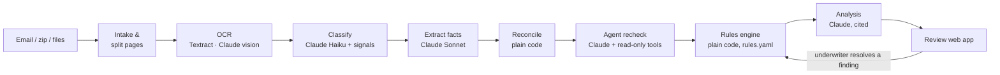

# Knight Commercial Auto Submission Intake

A working prototype for the Knight Insurance Group case study. It takes an emailed Commercial Auto
(trucking) submission, reads every document in it, cross-checks the documents against each other,
applies Knight's underwriting guideline, and gives the underwriter one page with the decision and
the evidence behind it.

**Live demo: https://kn-396aa269de6d4e37a0fb100d9174e008.ecs.us-east-1.on.aws**

The demo runs in *demo mode*: it replays a recorded live run on Amazon Bedrock, so every Claude
output you see is real, and clicking around costs nothing. Open the Cobalt Mesa submission, then try:
**Findings → F17** (the agent caught an OCR misread by looking at the license photo), any citation
chip under **Summary**, and **Mark resolved** on a finding to watch the rules re-run.

## What it found in the sample

On the case-study package (15 files, 33 pages and sheets) the pipeline produces:

- **22 documents**, classified by content, not file name (it flags `MTC 23-24.pdf`, named like a loss
  run, as a no-loss letter, and two license photos inside the MVR PDF).
- **357 extracted facts**, each with the quote and page it came from.
- **18 findings** across documents, including: an unscheduled driver (Kevin Brandt) and vehicle (2021
  Peterbilt) in the loss history; the Q4 IFTA return filed as an LLC while everything else says INC; 4
  power units on the schedule vs 5 on the quote; a Volvo VIN recorded as a Freightliner; a 16-character
  VIN; a 308-day coverage lapse; a missing prior-term loss run.
- **Agent recheck** of the 7 findings that could be reading mistakes: 6 confirmed as real, 1 corrected
  (the OCR read license `O7314062` as `07314062`; the agent viewed the photo and fixed it).
- **Decision: REFER → Small Fleet underwriting**, driven by 10 of Knight's 26 rules, with each failure
  linked to its evidence.
- **Analysis**: 13 concerns and 16 next actions (12 of them a request list for the agent), every one
  citing the findings, rules, documents or claims behind it.

## How it works



| Step | AI or code | What it does |
|---|---|---|
| 1. Intake | code | Expands .eml / .zip (nested, with zip-slip and zip-bomb guards); SHA-256 duplicate detection |
| 2. Preprocess | code | Splits PDFs into pages, detects text layers, extracts embedded photos, reads worksheets (hidden sheets excluded) |
| 3. OCR | AWS | Scans → Amazon Textract; photos → Claude vision |
| 4. Classify | Claude Haiku + code | Per page: keyword signals and the model, combined into one confidence; below 0.70 is flagged for review. Pages regrouped into documents (one MVR per driver, one loss run per term) |
| 5. Extract | Claude Sonnet + code | Facts per document type from `extraction/specs.py`. Each fact has a value, verbatim quote, page and confidence, then is checked in code: the quote must be on the page, dates and money normalized, VINs checked for length, characters and check digit |
| 6. Reconcile | code | Facts regrouped into entities (applicant, drivers by license number, vehicles by VIN, policy terms, IFTA quarters); disagreements become findings: conflict, gap, possible misread, outdated document, superseded |
| 7. Agent recheck | Claude Sonnet, tool use | For findings that might be reading errors, Claude investigates with four read-only tools (read page text, view page image, decode VIN, record verdict), capped at 6 turns. Every tool call is kept for audit |
| 8. Rules | code | Knight's guideline as data in `rules/rules.yaml`: 26 rules, each citing its guideline section, check, thresholds and outcome. Any decline → DECLINE, any fail or unverifiable → REFER, else PROCEED; routing by power units |
| 9. Analysis | Claude Sonnet + code | Summary, concerns and next actions written from an ID-labelled brief of steps 1–8 (never the raw PDFs). A code check removes unknown citations and drops uncited items |
| 10. Review app | FastAPI + React | Queue, upload with live progress, the decision, findings with the agent trace, rules, documents and facts, audit trail; every citation opens the source page with the quote highlighted |

## Design decisions

- **The decision is made by code, not by the model.** Eligibility and referral are Knight's rules,
  so they live in a YAML file an underwriter can read and change, checked by plain functions with
  tests. The model never sets or changes the outcome; a test feeds it an answer saying "DECLINE" and
  checks that the decision stays REFER.
- **AI where reading is hard, code where checking is easy.** Claude reads messy documents and
  investigates suspicious values; code verifies quotes, VINs, dates and arithmetic. Numbers the
  analysis quotes (claim reporting delays, totals) are computed in code and handed to the model.
- **Every statement is traceable.** Facts carry their quote and page; findings carry every source;
  analysis items must cite IDs that exist. Uncited claims are removed before anyone sees them.
- **A bounded agent, not an open-ended one.** The recheck agent only gets read-only tools on this
  submission, a turn limit, and must end with a structured verdict. It is a plain tool-use loop in
  under 130 lines (`agent/recheck.py`), with no agent framework, so every step is visible and testable.
- **Unknown is not pass.** If a rule cannot be verified from the documents (Whitfield's CDL date),
  it counts as a referral, never as a pass.
- **Human in the loop.** The underwriter confirms or resolves findings with a note; the rules re-run
  immediately and the history is kept.
- **Record and replay.** Every live Claude, Textract and vision call is saved to `fixtures/`, keyed
  by its exact input. Demo mode replays them byte for byte on any machine, which is what makes the
  hosted demo free and the tests deterministic.
- **Open questions are named settings.** Where the guideline is ambiguous (do "non-listed states"
  mean domicile or operations? does a baseline failure refer or decline?), the choice is a setting in
  `rules.yaml` with a default, shown on the page, not buried in code.

## Open questions for Knight

The guideline mockup leaves some points open. Each is decided by a named setting in
`rules/rules.yaml` (or a documented rule), so changing the answer is a one-line edit:

1. **"Non-listed states":** does it mean where the account is based, or anywhere it operates?
   Assumed *domicile*; operating miles in other states are reported, not prohibited
   (`non_listed_states_scope`).
2. **Safe-driver baseline failures** (e.g. a scheduled driver with no CDL): refer or decline?
   Assumed *refer*, so the driver can be excluded or the record corrected (`baseline_failure_outcome`).
3. **Which date do the 60-day, 90-day and 3-year windows count from:** the application date or
   the effective date? Assumed *application date* (`window_anchor`).
4. **Which document sets the power-unit count for routing** when they disagree? The vehicle schedule
   is used (4 units here; the quote says 5). Both route to Small Fleet, and the conflict is flagged.
5. **Is a no-loss letter acceptable instead of a loss run**, for cargo in particular? Treated as weaker
   evidence: accepted, but flagged ("no paid losses" says nothing about open claims).
6. **How should "within 50 miles of the Mexico border" be established?** The documents can't show it,
   so it is reported for the agent to confirm, not failed.

## AWS

| Service | Use |
|---|---|
| Amazon Bedrock | Claude Haiku 4.5 (classification) and Sonnet 4.6 (extraction, agent, analysis), via US cross-region inference profiles |
| Amazon Textract | OCR of scanned pages |
| Amazon ECS (Express Mode, Fargate) | Hosts the container behind an HTTPS load balancer; one task |
| Amazon ECR | Container images, pushed by GitHub Actions |
| Amazon CloudWatch | Container logs (each job logs its steps and decision) and metrics |
| IAM | Separate least-privilege users: Bedrock/Textract for live runs, ECR push only for CI |

CI (`.github/workflows/ci.yml`) runs the test suite on every push and, on `main`, builds the image and
pushes it to ECR.

## Security and privacy

Submissions carry personal data: FEIN or SSN (owner-operators often use their SSN), driver names,
dates of birth and license numbers, MVRs (covered by the Driver's Privacy Protection Act) and claims
history. Everything in this repository and the demo is fictitious.

**In the prototype:** live runs use Amazon Bedrock, so documents stay in the AWS account and US
region and are not used to train models; the hosted demo holds no AWS permissions to call models;
IAM users are least-privilege (Bedrock/Textract for live runs, ECR push only for CI); keys live in
GitHub secrets and local AWS profiles, never in code; the analysis brief contains no FEINs or license
numbers.

**For production:**

- **Minimize what the model sees.** Mask FEIN, SSN, dates of birth and license numbers before text
  reaches the model (pattern matching or Amazon Comprehend PII detection), keep real values in an
  encrypted store, and match them in code. Rule C1 only needs to know a FEIN is present.
- **Amazon Bedrock Guardrails** with sensitive-information filters on inputs and outputs.
- **No copies left behind.** Recording off (`RECORD_LLM=false`), Bedrock invocation logging off or
  encrypted, PII masked in CloudWatch logs and in the agent's audit trail.
- **Encryption and retention.** S3 and the database encrypted with KMS keys; documents deleted a set
  time after the decision.
- **Private network paths.** VPC endpoints for Bedrock, Textract and S3.
- **Access and audit.** SSO sign-in, role-based access, CloudTrail, and a check that each MVR use is a
  DPPA permissible purpose.

## Modes

| Mode | AI | OCR | Needs |
|---|---|---|---|
| `demo` (default) | replays recorded responses | replays recorded OCR (Tesseract for new files) | nothing |
| `aws` | Amazon Bedrock | Textract / Claude vision | an AWS profile with Bedrock and Textract access |
| `local` | Anthropic API | Tesseract / Claude vision | `ANTHROPIC_API_KEY` |

In demo mode a *new* upload still runs every step that needs no AI (intake, OCR, reconciliation,
rules); the AI steps show as not run. Live mode on a server is gated by `ACCESS_CODE`: every upload,
rerun and review needs the code, uploads are capped at 25 MB, and jobs run one at a time.

## Run it locally

```bash
cd backend
pip install -r requirements.txt          # plus the tesseract binary for new uploads in demo mode
uvicorn app.api.main:app --port 8000     # http://localhost:8000; the sample is processed on start
pytest -q                                # 52 tests
```

Pipeline only: `python -m app.pipeline.run "../samples/cobalt-mesa/Sample Submission - Cobalt Mesa Transport.zip"`.
As a container: `docker build -t knight-intake . && docker run -p 8000:8000 knight-intake`.

**Recording a live run.** Run with `APP_MODE=aws` and commit `fixtures/`. After changing one prompt,
add `REUSE_RECORDINGS=true` so only the changed calls go to Bedrock.

**Frontend.** React source in `frontend/src`, bundled with esbuild; the bundle in `frontend/dist` is
committed so the server needs only Python (`cd frontend && npm install && npm run build` to rebuild).

## Repository map

```
backend/app/
  pipeline/     intake, preprocess, classify, extract, verify (code checks), run (orchestrator)
  extraction/   specs.py: which facts to read from each document type, mapped to the rules
  reconcile/    entities and cross-document checks
  agent/        the recheck agent: tools and the tool-use loop
  rules/        rules engine and one check function per rule kind
  analysis/     the brief builder and the cited analysis
  api/          FastAPI routes, background jobs, storage, underwriter review
  providers/    Bedrock / Anthropic / replay LLMs, Textract / vision / Tesseract OCR
rules/rules.yaml   Knight's guideline as data
fixtures/          recorded Bedrock and Textract responses (demo mode and tests)
frontend/src/      React app
tests/             52 tests, including the expected-findings test in test_reconcile.py
```

## What's next

This is a prototype. For production I would:

- **Move state off the container**: originals to S3 (the storage interface and an S3 class exist but
  are not wired in), submissions and reviews to a database. Then the service can run several tasks
  and nothing is lost on a restart; today the demo keeps state on one task's disk.
- **Queue the work**: uploads to SQS, a worker service to process them, so the web tier stays light
  (a queue interface exists, not yet wired in).
- **Real sign-in** (Cognito or the carrier's SSO) instead of an access code, with reviewer identity on
  every review.
- **Email intake**: SES receiving into S3, so submissions arrive without an upload.
- **More samples and an evaluation set**, to measure extraction accuracy per field and tune the
  review threshold.
- **Close the loop**: send the agent request list from the app, and re-run when documents arrive.

All companies, people and records in `samples/` are fictitious and were provided with the case study.
